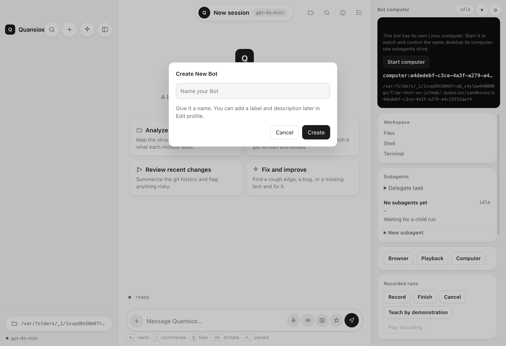

# “+ creates a Bot” — Grok Bot verification and Quansiox parity

## What Grok Bot does (code, v0.71.2)

The sidebar `+` is labelled **New Bot** (`i18n 2hjDEV`) and its click handler is
`openCreateBot`, not an immediate empty chat:

```js
// dist/renderer/assets/index-wlkGG389.js (sidebar header)
r.jsx(Sa, {
  "aria-label": g({ id: "2hjDEV" }),   // "New Bot"
  icon: "plus",
  onClick: m,                          // onNewBot
})
// -> { openCreateBot: Ya } -> openCreateBot() sets state { initialName }
```

`openCreateBot` renders `aX`, the Create New Bot dialog (`sand-create-bot-dialog`):

- Title `nHOJ2T` = **Create New Bot**
- `input` placeholder `2DQ7aH` = **Name your Bot**, aria-label `RFtRvq` = **Bot name**
- avatar shape + colour picker (`Gv`)
- Actions `dEgA5A` = **Cancel**, `hYgDIe` = **Create**, `/DwR+n` = **Creating…**

On submit it creates the agent up front and kickstarts it:

```js
// index-wlkGG389.js @ ~1,551,587
await roster.createAgent({
  clientNonce, name, description: "", origin: "user",
  isKickstartRequested: true, avatarShape, avatarColor,
});
await launcher.kickstartAwaitingFirstMessage(agent.id);
```

The same dialog is used by `⌘N` and the command-palette **New Bot** entry
(`{ id: "sand.newAgent", hotkey: "mod+n" }`).

## What Quansiox does now

- `+`, `⌘N`, `/new`, and palette **New Bot** open **Create New Bot**
  (`data-surface="new-bot-dialog"`) instead of silently creating an untitled
  session.
- Submitting calls the new `sessions.create` IPC
  (`sessionService.create`), which writes the named bot immediately so it
  appears in the sidebar with its chosen name; then selects it.
- Labels match Grok: title, `Name your Bot`, `Bot name`, `Cancel`, `Create`,
  `Creating…`.



Differences kept deliberately local-first:

- Grok lets you choose an avatar shape/colour; Quansiox generates each bot’s
  avatar from its name (existing `avatars.generate`).
- Grok kickstarts a model greeting after creation; Quansiox creates an empty
  bot and does not spend tokens until you send the first message. Edit profile
  (`sessionService.update`) adds label/description later.

Verified by `test/session-create.js` (named create, defaults, list, id
validation) and the real-Electron renderer check, which fills the dialog and
asserts the selected bot changed (`newBotDialog: true`, `stageSwitched: true`).
