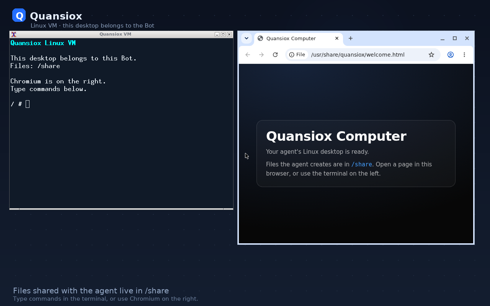

# Per-bot computer — Grok Bot RE and Quansiox implementation (code-verified)

This note is evidence-first: every claim about Grok Bot 0.71.2 is read from the
extracted `app.asar` bundle (byte offsets in the minified files), and every claim
about Quansiox is read from `src/` at the line shown. Product docs are not used
as evidence. Live checks were run on this Mac (macOS 27.0.1, arm64, VZ present).

Extraction: `/tmp/qx-grok/app` (`dist/electron-main`, `dist/node-agent-coordinator`,
`dist/local-exec-daemon`, `dist/renderer/assets`).

## 1. In Grok Bot, the computer belongs to the Bot

The renderer derives the box id from the **active agent id**, not from a global
account:

```js
// dist/renderer/assets/index.eager-app-DSuGVQNC.js @ ~1,341,368
const L = () => {
  const Te = a.get(), qe = l.get().agents, _e = t_e(Te, qe)?.isGroup ?? !1;
  return { boxId: _e ? null : Te.currentAgentId, isCurrentGroup: _e };
};
```

- A normal Bot has `boxId = agentId`; a group chat has **no** box.
- The desktop methods are keyed by that id:
  `getForeverBoxStatus({id})`, `ensureForeverBox({id})`,
  `handBackForeverBox({id, trigger, requestId})` (`main-app.cjs` method table).
- A box is a real backend sandbox, not a screenshot tool. The response schema
  (`proto.cjs` @ ~814,931):

```
EnsureSandBoxResponse
 1 cluster  2 tenant_id  3 pod_id  4 network_token
 5 exec_daemon_auth_token  6 exec_daemon_url  7 vnc_url
 8 terminals_folder  12 fork_vnc_base_url  9 image_update_available
 10 gateway_url  11 gateway_token  13 run_state  14 egress_tunnel_ownership  15 image
```

`run_state` includes `ABSENT / HIBERNATED / RUNNING / STARTING`; the UI states
are literal (creating / starting / waking / recovering / recreating / resetting
Grok Bot's computer), i.e. a persistent machine with a lifecycle, not a per-task
process.

The Bot's live state carries the machine handoff:

```
// proto.cjs / coordinator protobuf
GrokBotAgentLiveState
 1 agent_id  2 is_running  3 is_composing_message  4 is_retrying  5 activity
 6 awaiting  7 updated_at_ms  8 stale_after_ms
 9 box_handoff_request_id  10 box_handoff_instruction
 11 session_id  12 active_group_member_id  13 has_running_subagents
 14 surface_task_id
```

Together with `EndGrokBotBoxHandoffRequest {agent_id, request_id, trigger}` this
is the "give the computer to this run / take it back" protocol.

## 2. The screen is a live VNC webview per box

The viewer is not a JPEG polling loop. It is a sandboxed `<webview>` that loads
the box's noVNC URL:

```js
// dist/renderer/assets/chunk-teach-recording-controls-CQ4-Ikje.js
webview({
  partition: "persist:sand-forever-box",
  src: url,                       // box vnc_url
  webpreferences: "contextIsolation=yes,nodeIntegration=no,sandbox=yes",
})
// URL: autoconnect=true, resize=scale, reconnect=true, sandInteractive=1
```

- The box URL embeds a display token in its `path` query (port token per box
  window). The main process proxies websockify and injects
  `x-anyrun-port-token` and `x-anyrun-network-token` headers
  (`main-app.cjs`, "computer-screen-websocket" + `preload-vnc.cjs`).
- The webview talks back over `sand:vnc-session`,
  `sand:vnc-liveness`, and a host-key channel; the renderer keeps a **warm pool**
  of VNC webviews (`sand-box-vnc-pool`) so switching monitors is instant, with
  an idle limit and crash/retry logic.
- Frames are captured from the noVNC canvas only for **previews** (JPEG, 3 s
  cadence), not for the main view.

## 3. Subagents share the Bot's box; the UI can focus a child's use of it

```js
// local-exec-daemon/main.cjs @ ~2,094,659
SubagentExecutionEnvironment = UNSPECIFIED | LOCAL | CLOUD

// local-exec-daemon/main.cjs @ ~2,170,263
ComputerUseArgs {
  tool_call_id, actions, description, bind_unmapped_characters,
  desktop_lease_actor_id,                 // which actor holds the desktop
  screenshot_settle_ms, native_x11_driver
}

SubagentType = computer_use | browser_use | bash | shell | vm_setup_helper | ...
```

- `desktop_lease_actor_id` is the lease guard for concurrent computer users: a
  computer-use child acts under an actor id, not by silently sharing global
  input.
- The renderer builds the "monitor strip" from **running `computerUse`
  subagents** and the Bot's box status; each row carries
  `{subagentId, title, vncUrl, handoff}` (`index-wlkGG389.js` @ ~1,430,657).
  `openBox(subagentId)` / `handBack(subagentId)` hand the same screen between
  the Bot and a child.
- A synchronous child can be promoted with `ForceBackgroundSubagent`, and
  `continuation_config` (`max_loops`, `nudge_message`, `collectBackgroundChildren`)
  supervises the loop. So orchestration is: Bot owns box → children run against
  it → child computer-use is a leased actor on the same desktop → UI focuses
  the actor's screen and can hand control back.

## 4. Quansiox before this change (src, not docs)

| Claim | Code reality |
|---|---|
| "per-bot computer" | `desktop.boot` was only called by the **Display** button in `src/renderer-src/main.jsx`; no service tied a guest to a session. `src/main/services/desktopVmService.js` had no caller at session start. |
| Boot readiness | `desktopVmService.boot` resolved when `5900.sock` **existed**. The qx-vm host creates that socket at spawn; x11vnc answers ~3 s later. Live probe: file existed after 126 ms, first connect got a closed socket with no greeting. |
| Per-child computers | `src/main/services/computerPool.js` is **not referenced anywhere in `src/`** (`grep -rn computerPool src` → the service file only). `runChildSession` gives `environment: isolated` a separate **file sandbox**, never a guest. |
| Agent computer calls | `agentService` routed to the guest only if `guestComputerBridge.isAttached(sessionId)`; otherwise it drove the **user's Mac**. Nothing attached a guest except the manual button. |
| Guest screenshot | returned `{ok, dataUrl, ...}` with no `id`/`coordinateToken`, while the coordinator consumes `result.data` and the token. A guest screenshot through the agent path was broken. |
| Viewer CSP | `src/renderer/index.html` had `connect-src 'self'`; the noVNC viewer connects to `ws://127.0.0.1:<ephemeral>`, so the live screen could never paint in the shipped app even when the VM was up. |
| Workspace root | `workspaceRoot` defaulted to `''` and every consumer used `|| process.cwd()`. A Finder launch has cwd `/`, producing `/.quansiox/sandboxes/<id>` and `ENOENT` ("Session sandbox could not start"). |
| UI | labelled the session "Session sandbox … Shell and files. No desktop display." even while a desktop VM existed. |

## 5. What changed (this pass)

- `src/main/services/desktopVmService.js:33` — readiness is a real RFB banner
  probe (`RFB 003.008\n`), retried until the guest answers; console pipes are
  drained so a verbose init cannot block the VM.
- `src/main/services/computerRuntimeService.js` — per-session computer runtime:
  lazy, single-flight boot; screen bridge + RFB input attach; phases
  `off → starting → ready → off|error`; state events; stop/recover/reset;
  capacity cap (4, `QUANSIOX_MAX_COMPUTERS`); honest `COMPUTER_UNAVAILABLE`.
- `src/main/services/agentService.js:100` — a bot's `computer_*` lazily
  provisions **its own** guest and drives it; `QUANSIOX_COMPUTER_TARGET=host`
  opts out; if the host can run a guest but boot fails, the call errors instead
  of silently driving the Mac.
- `src/main/services/guestComputerBridge.js:18` — default RFB client factory
  (no longer dependent on main bootstrap order), screenshot result parity
  (`{id, data, width, height, coordinateToken, frameHash, screenChanged}`) and
  the same coordinate-token gate as the Mac service.
- `src/main/ipc/namespaces.js:281` — `computer.status/ensure/screen/stop/recover/reset/list`
  + `onState`; `desktop.*` now delegates to the runtime.
- `src/main/services/sandboxService.js:211` — `describe()` reports
  `desktopDisplay`, `desktopPhase`, `desktopUrl`, `browserRuntime`.
- `src/main/services/settingsService.js` — `workspaceRoot` is normalized on
  read (empty or `/` → `~/Quansiox`, overridable with
  `QUANSIOX_DEFAULT_WORKSPACE`); `ensureWorkspaceRoot()` creates and persists it
  at startup, so a Finder launch no longer builds `/.quansiox/...`.
  `sandboxRoot()` uses that accessor. Covered by `test/workspace-root.js`,
  including a Finder-cwd (`/`) sandbox boot.
- `src/renderer-src/main.jsx:1372` — the stage panel is now the Bot's computer:
  phase badge, Start/Stop, live noVNC view; subagent rows remain, and children
  share the Bot's screen because their `computerCall` carries the parent
  session id.
- `src/renderer/index.html` — `connect-src 'self' ws://127.0.0.1:*` so the
  loopback noVNC bridge is allowed. `test/renderer-check-main.js` now opens a
  real loopback WebSocket in the renderer and fails on a CSP regression.
- `scripts/package.js` — re-signs `qx-vm.next` with the virtualization
  entitlement (see the packaged check below).
- `src/main/index.js:210` — quit reaps every live guest.
- Tests: `test/computer-runtime.js` (new), `test/desktop-vm.js` (real banner
  server), `test/guest-bridge-live.js` (FramebufferUpdate + token + input),
  `test/guest-computer-bridge.js` (token gate).

Live check on this Mac (same binary/image the app ships):

```
READY {"phase":"ready","url":"ws://127.0.0.1:50794","input":true,"ms":4200}
EVENTS starting > ready
RFB BANNER "RFB 003.008\n"
SCREENSHOT 1280 800 token true hash d5a17139 png 39194
STOPPED off
```

Packaged check (`release/Quansiox.app`, after ad-hoc re-signing):

```
PACKAGED VM READY (RFB greeting)
PACKAGED RFB 1280 800 "Quansiox" png 39194
```



Packaging fix included: `scripts/package.js` now re-signs **both** `vm/qx-vm` and
`vm/qx-vm.next` with `vm/qx-vm.entitlements`. `codesign --deep` strips
`com.apple.security.virtualization` from nested binaries; without this the
desktop guest boots in dev and fails only in the shipped app.

Auto-provision is limited to the real Electron main (`process.versions.electron`);
plain-node test harnesses keep the host/fake path, so `npm test` does not boot
4 GB VMs. `QUANSIOX_COMPUTER_TARGET=guest` forces the guest for E2E scripts,
`=host` forces the old host-Mac path; `QUANSIOX_MAX_COMPUTERS` caps the fleet.

## 6. Remaining gap (honest)

- Shell/files still use `sandboxService`/`vmSandboxService`; the desktop guest
  also exposes a TSV console, but it is not yet the same runtime identity.
- `browser_*` still drives the Electron browser. The guest Chromium publishes
  CDP at `9222.sock`; routing browser tools there is the next unification step.
- Isolated children can boot their own guest (keyed by job id) but the UI has no
  monitor strip for non-active sessions, and there is no box persistence/handoff
  across app restarts.
- Cloud boxes (`fork_vnc_base_url`, hibernation, fleet ops) stay out of scope
  for a local-first app.
